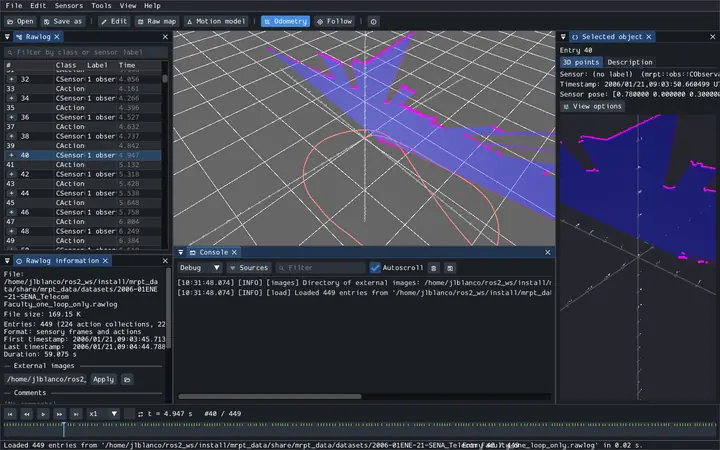
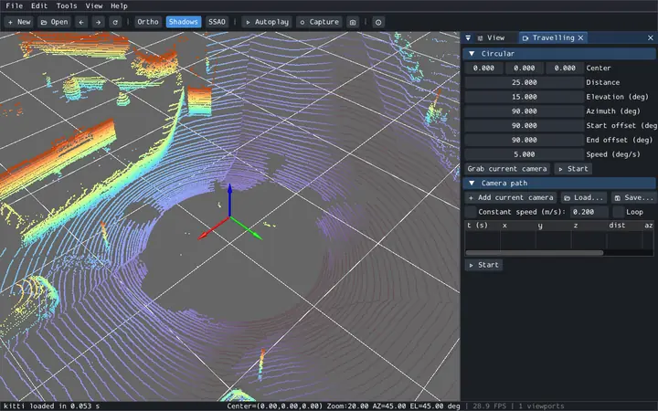
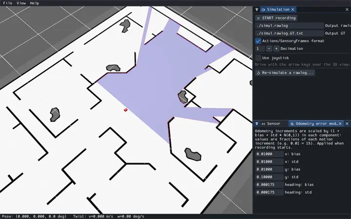
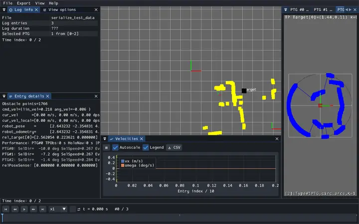
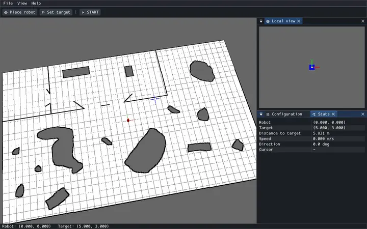
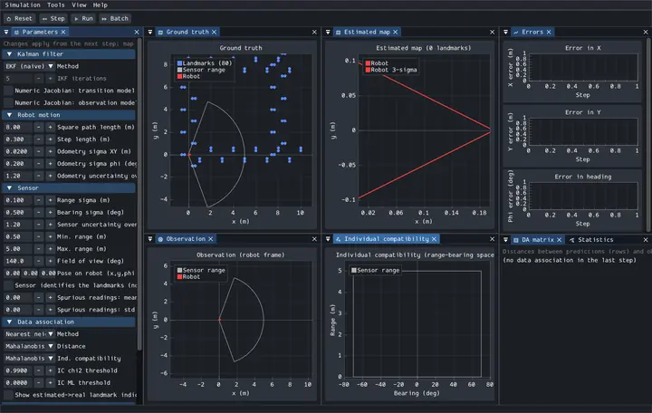

<div align="center">

# Mobile Robot Programming Toolkit (MRPT)

**C++ and Python libraries and apps for mobile robotics: SLAM, localization, navigation,<br/>
3D geometry, sensors and visualization. Open source since 2005.**

[](https://github.com/MRPT/mrpt/actions/workflows/build-linux.yml)
[](https://github.com/MRPT/mrpt/actions/workflows/build-macos.yml)
[](https://github.com/MRPT/mrpt/actions/workflows/build-windows.yml)
[](https://codecov.io/gh/MRPT/mrpt)

[](https://github.com/MRPT/mrpt/releases)
[](https://pypi.org/project/mrpt3/)
[](https://repology.org/project/mrpt/versions)
[](https://zenodo.org/doi/10.5281/zenodo.10595286)
[](https://www.mrpt.org/License/)

[**Documentation**](https://docs.mrpt.org/reference/latest/) · [**Tutorials**](https://docs.mrpt.org/reference/latest/tutorials.html) · [**API Reference**](https://docs.mrpt.org/reference/latest/modules.html) · [**Examples**](https://docs.mrpt.org/reference/latest/examples.html) · [**Applications**](https://docs.mrpt.org/reference/latest/applications.html) · [**Discussions**](https://github.com/MRPT/mrpt/discussions)

<a href="https://mrpt.github.io/videos/mrpt_hero_v1.mp4"></a>

</div>

---

## What is MRPT?

MRPT is a modular C++ framework for mobile robotics, started in 2005 at the University of Málaga and
actively maintained since then, with Python bindings for most of it. It is used in research and industry,
and it is the core library of the [MOLA](https://github.com/MOLAorg/mola) SLAM framework and the
[MVSim](https://github.com/MRPT/mvsim) simulator.

**MRPT 3** splits the library into independent colcon packages, cleans up the public API and moves to
modern C++17, while keeping the data structures and algorithms MRPT has always been known for.

| Area | What's included |
|---|---|
| **SLAM & localization** | Particle filter localization, RBPF, EKF and graph SLAM, ICP; 3D LiDAR odometry and SLAM through [MOLA](https://github.com/MOLAorg/mola) |
| **Geometry** | SE(2)/SE(3) poses and Lie groups, probability distributions over poses, geodetic/UTM/ENU coordinates |
| **Estimation** | Kalman and particle filters, RANSAC, least squares |
| **Maps** | 2D/3D occupancy grids, point clouds, voxel maps, OctoMap, landmark and gas maps |
| **Sensors** | Dataset (rawlog) support for LiDARs, cameras, RGB-D, IMU, GNSS; hardware drivers |
| **Navigation** | Reactive navigation with PTGs, path planning |
| **Visualization** | 3D scene graph rendered with OpenGL (shadows, SSAO, instancing), ImGui-based apps and windows |
| **Python** | pybind11 bindings for the main modules; pip wheels for Linux |
| **Platforms** | Linux, Windows, macOS; ROS 2 Humble, Jazzy, Kilted, Lyrical and Rolling |

---

## Install

### Python (pip)

```bash
pip install mrpt3
```

```python
from mrpt.poses import CPose3D
print(CPose3D(1.0, 2.0, 0.0, 0.5, 0.0, 0.0) + CPose3D(0.5, 0.0, 0.0, 0.0, 0.0, 0.0))
```

Linux (x86_64, aarch64), Python 3.10 or newer. The wheel also contains the C++ headers, libraries
and CMake files. See the [Python examples](https://docs.mrpt.org/reference/latest/python_examples.html)
and the interactive [MRPT notebooks](https://github.com/MRPT/mrpt-notebooks).

### ROS 2

```bash
# All libraries and apps:
sudo apt install ros-$ROS_DISTRO-mrpt-apps-cli ros-$ROS_DISTRO-mrpt-apps-gui
# Or only the modules you need, e.g.:
sudo apt install ros-$ROS_DISTRO-mrpt-maps
```

| Distro | Build dev | Release |
| --- | --- | --- |
| ROS 2 Humble (u22.04) | [](https://build.ros2.org/job/Hdev__mrpt3__ubuntu_jammy_amd64/) | [](https://index.ros.org/?pkgs=mrpt3&search_packages=true#humble) |
| ROS 2 Jazzy (u24.04) | [](https://build.ros2.org/job/Jdev__mrpt3__ubuntu_noble_amd64/) | [](https://index.ros.org/?pkgs=mrpt3&search_packages=true#jazzy) |
| ROS 2 Kilted (u24.04) | [](https://build.ros2.org/job/Kdev__mrpt3__ubuntu_noble_amd64/) | [](https://index.ros.org/?pkgs=mrpt3&search_packages=true#kilted) |
| ROS 2 Lyrical (u26.04) | [](https://build.ros2.org/job/Ldev__mrpt3__ubuntu_resolute_amd64/) | [](https://index.ros.org/?pkgs=mrpt3&search_packages=true#lyrical) |
| ROS 2 Rolling (u26.04) | [](https://build.ros2.org/job/Rdev__mrpt3__ubuntu_resolute_amd64/) | [](https://index.ros.org/?pkgs=mrpt3&search_packages=true#rolling) |

Binary builds of every package, per distro and platform (Ubuntu amd64/arm64, RHEL, Fedora):
[ROS build farm status](packaging/ROS_BUILD_STATUS.md).

### Ubuntu (PPA)

```bash
sudo add-apt-repository ppa:joseluisblancoc/mrpt3-stable   # or mrpt3-develop, for nightly builds
sudo apt install libmrpt-dev mrpt-apps
```

For Ubuntu 24.04 and 26.04. Other distributions: see [which ones package MRPT](https://repology.org/project/mrpt/versions).

### Windows

[Nightly Windows installer](https://github.com/MRPT/mrpt/releases/tag/Windows-nightly-builds), with the
apps (`.exe`), libraries (`.dll`, `.lib`) and headers.

### Build from source

```bash
git clone https://github.com/MRPT/mrpt.git --recursive
cd mrpt
```

Install build dependencies with `rosdep` (recommended, works even without ROS installed):

```bash
sudo apt install python3-rosdep
sudo rosdep init   # only once per machine
rosdep update
rosdep install --from-paths . --ignore-src -r -y
```

Then build with `colcon`:

```bash
colcon build
```

See the full [build guide](https://docs.mrpt.org/reference/latest/compiling.html) for CMake options
and dependencies.

---

## Quick start (C++)

Align two point clouds with ICP:

```cpp
#include <mrpt/maps/CSimplePointsMap.h>
#include <mrpt/random.h>
#include <mrpt/slam/CICP.h>

#include <iostream>

int main()
{
  // A random 2D point cloud, and the same points seen from another pose:
  mrpt::maps::CSimplePointsMap ref;
  auto& rng = mrpt::random::getRandomGenerator();
  for (int i = 0; i < 1000; i++)
  {
    ref.insertPoint(rng.drawUniform(-10.0f, 10.0f), rng.drawUniform(-10.0f, 10.0f));
  }
  const mrpt::poses::CPose2D truePose(0.5, -0.3, mrpt::DEG2RAD(10.0));
  mrpt::maps::CSimplePointsMap scan = ref;
  scan.changeCoordinatesReference(-truePose);

  // Align them with ICP, starting from the identity:
  mrpt::slam::CICP icp;
  const auto pdf = icp.Align(&ref, &scan, mrpt::poses::CPose2D());

  std::cout << "True pose: " << truePose << "\nICP:       " << pdf->getMeanVal() << "\n";
}
```

```cmake
cmake_minimum_required(VERSION 3.16)
project(my_robot_app)

find_package(mrpt_slam REQUIRED)

add_executable(icp_example icp_example.cpp)
target_link_libraries(icp_example mrpt::mrpt_slam)
```

More in the [C++ examples](https://docs.mrpt.org/reference/latest/examples.html).

> **Migrating from MRPT 2.x?** See the [porting guide](https://docs.mrpt.org/reference/latest/page_porting_mrpt3.html):
> packages were renamed from `mrpt-<name>` to `mrpt_<name>`, and CMake targets from `mrpt::<name>` to `mrpt::mrpt_<name>`.

---

## Applications

GUI apps for datasets, 3D scenes, navigation and SLAM, plus command-line tools such as `rawlog-edit`.
See [all applications](https://docs.mrpt.org/reference/latest/applications.html).

<table>
<tr>
<td align="center" width="33%"><a href="https://docs.mrpt.org/reference/latest/app_RawLogViewer.html"><br/><b>RawLogViewer</b></a><br/>Inspect, edit and process datasets</td>
<td align="center" width="33%"><a href="https://docs.mrpt.org/reference/latest/page_app_SceneViewer3D.html"><br/><b>SceneViewer3D</b></a><br/>3D scenes, models and point clouds</td>
<td align="center" width="33%"><a href="https://docs.mrpt.org/reference/latest/app_GridmapNavSimul.html"><br/><b>GridmapNavSimul</b></a><br/>Simulate a robot and its sensors in a map</td>
</tr>
<tr>
<td align="center"><a href="https://docs.mrpt.org/reference/latest/page_app_navlog-viewer.html"><br/><b>navlog-viewer</b></a><br/>Debug reactive navigation logs</td>
<td align="center"><a href="https://docs.mrpt.org/reference/latest/page_app_holonomic-navigator-demo.html"><br/><b>holonomic-navigator-demo</b></a><br/>Holonomic obstacle avoidance</td>
<td align="center"><a href="https://docs.mrpt.org/reference/latest/app_2d-slam-demo.html"><br/><b>2d-slam-demo</b></a><br/>EKF SLAM step by step</td>
</tr>
</table>

---

## Ecosystem

Projects built on MRPT:

| Project | Description |
|---|---|
| [MOLA](https://github.com/MOLAorg/mola) | Modular LiDAR odometry, SLAM and localization, for ROS 2 or standalone |
| [mp2p_icp](https://github.com/MOLAorg/mp2p_icp) | Point cloud registration (ICP) and processing pipelines |
| [MVSim](https://github.com/MRPT/mvsim) | Lightweight, realistic 2.5D simulator for mobile robots and multi-agent research |
| [mrpt_path_planning](https://github.com/MRPT/mrpt_path_planning) | Kinematically-feasible path planning (TPS-A*) for arbitrary robot shapes |
| [mrpt_navigation](https://github.com/mrpt-ros-pkg/mrpt_navigation) | ROS 2 nodes for localization, map servers, path planning and reactive navigation |
| [mrpt_sensors](https://github.com/mrpt-ros-pkg/mrpt_sensors) | ROS 2 drivers for robotics sensors |
| [mrpt_ros_bridge](https://github.com/MRPT/mrpt_ros_bridge) | Conversions between MRPT classes and ROS 2 messages |
| [mrpt-notebooks](https://github.com/MRPT/mrpt-notebooks) | Interactive Python tutorials ([marimo](https://marimo.io) notebooks) |

---

## Modules

Each module is an independent colcon package that can be built and used on its own:

| Group | Modules |
|---|---|
| Foundations | `mrpt_common` `mrpt_core` `mrpt_typemeta` `mrpt_rtti` `mrpt_containers` `mrpt_serialization` `mrpt_io` `mrpt_system` `mrpt_config` `mrpt_expr` `mrpt_random` `mrpt_comms` |
| Math & geometry | `mrpt_math` `mrpt_poses` `mrpt_tfest` `mrpt_bayes` `mrpt_graphs` `mrpt_topography` `mrpt_kinematics` |
| Sensors & data | `mrpt_obs` `mrpt_img` `mrpt_hwdrivers` `mrpt_data` |
| Maps, SLAM & navigation | `mrpt_maps` `mrpt_slam` `mrpt_graphslam` `mrpt_nav` |
| Visualization & GUI | `mrpt_viz` `mrpt_opengl` `mrpt_gui` `mrpt_imgui` `mrpt_imgui_vendor` |
| Apps & examples | `mrpt_libapps_cli` `mrpt_libapps_gui` `mrpt_apps_cli` `mrpt_apps_gui` `mrpt_examples_cpp` |

---

## Documentation

| Resource | Link |
|---|---|
| API reference | [docs.mrpt.org/reference/latest/modules.html](https://docs.mrpt.org/reference/latest/modules.html) |
| Tutorials | [docs.mrpt.org/reference/latest/tutorials.html](https://docs.mrpt.org/reference/latest/tutorials.html) |
| C++ examples | [docs.mrpt.org/reference/latest/examples.html](https://docs.mrpt.org/reference/latest/examples.html) |
| Python examples | [docs.mrpt.org/reference/latest/python_examples.html](https://docs.mrpt.org/reference/latest/python_examples.html) |
| Python API reference | [docs.mrpt.org/reference/latest/python_api.html](https://docs.mrpt.org/reference/latest/python_api.html) |
| Docs for AI agents | [llms.txt](https://docs.mrpt.org/reference/latest/llms.txt), [examples.json](https://docs.mrpt.org/reference/latest/examples.json), and a `.md` version of every page |
| Supported sensors | [docs.mrpt.org/reference/latest/supported-sensors.html](https://docs.mrpt.org/reference/latest/supported-sensors.html) |
| ROS wrappers | [docs.mrpt.org/reference/latest/wrappers.html](https://docs.mrpt.org/reference/latest/wrappers.html) |
| Changelog | [docs.mrpt.org/reference/latest/page_changelog.html](https://docs.mrpt.org/reference/latest/page_changelog.html) |
| Robotics datasets | [mrpt.org/robotics_datasets](https://www.mrpt.org/robotics_datasets) |

---

## Community & support

- **Questions and ideas**: [GitHub Discussions](https://github.com/MRPT/mrpt/discussions)
- **Bugs and feature requests**: [GitHub Issues](https://github.com/MRPT/mrpt/issues)
- **Contributing**: see [CONTRIBUTING.md](.github/CONTRIBUTING.md)
- Older Q&A: [Stack Overflow `[mrpt]`](https://stackoverflow.com/search?q=mrpt) and the [mrpt-users mailing list](https://groups.google.com/forum/#!forum/mrpt-users)

## Citing MRPT

If MRPT helps your research, please cite it with its Zenodo DOI
[10.5281/zenodo.10595286](https://doi.org/10.5281/zenodo.10595286), which resolves to the latest release
and provides BibTeX and other formats.

## License

Released under the [BSD 3-Clause License](https://www.mrpt.org/License/).

## Contributors

<a href="https://github.com/MRPT/mrpt/graphs/contributors">
  
</a>
