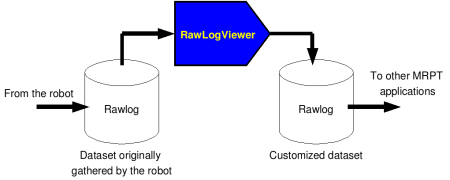
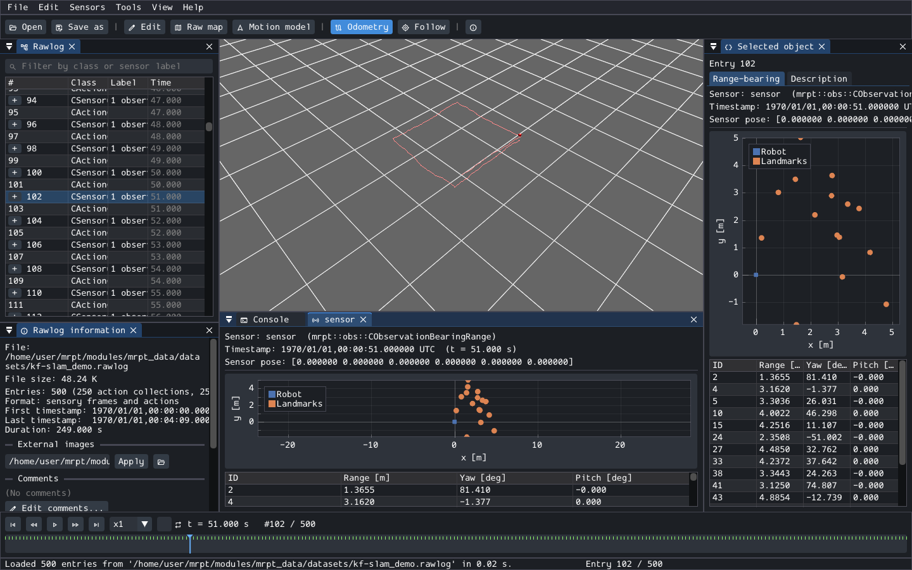
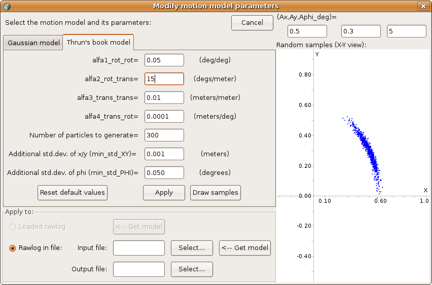

.. _app_RawLogViewer:

====================================================
Application: RawLogViewer
====================================================

.. contents:: :local:

1. Purpose of this program
----------------------------

The main goal of the GUI program RawLogViewer is to allow users to
**quickly inspect**, cut, or modify in many different ways a
given :ref:`Rawlog (datasets)<robotics_file_formats>`  gathered by a robot,
with the idea of preparing it as the input to some other program, typically for
localization (pf-localization) or mapping (kf-slam, rbpf-slam,...):

Examples of typical operations are extracting just a part of a large dataset,
decimating the rawlog if original data was gathered at a very high rate, or
modifying the sensor poses with respect to the robot/vehicle frame of reference.

The program also permits importing and exporting datasets to other formats.
Limited exporting is also implemented into plain text files, e.g. for processing
data in MATLAB. Note that future development of this program will focus on
visualization only, while modification of datasets should preferably be done
by means of the program ``rawlog-edit``.

This video demonstrates RawLogViewer inspecting some datasets with
Velodyne 3D Lidar data, as well as others with 2D lidars and 3D RGB+D cameras:

.. raw:: html

    

        <iframe src="https://www.youtube.com/embed/Dau0ir_L77w" frameborder="0" allowfullscreen style="position: absolute; top: 0; left: 0; width: 100%; height: 100%;"></iframe>
    

Another (older) video demonstrating RawLogViewer inspecting RGB+D datasets grabbed
with Microsoft Kinect:

.. raw:: html

    

        <iframe src="https://www.youtube.com/embed/RZhMZWRplO0" frameborder="0" allowfullscreen style="position: absolute; top: 0; left: 0; width: 100%; height: 100%;"></iframe>
    

2. Interface description
----------------------------

The main window shows the 3D view as its background, and a set of panels
that can be docked anywhere (the layout is remembered between sessions):

- **Rawlog** (left): all the entries of the dataset, with their class, sensor
  label and time. Sensory frames can be expanded to see their observations.
  The filter box at its top shows only the entries of a given class or sensor
  label. Right-click an entry for more options.

- **Timeline** (bottom): one row of tick marks per sensor. Click or drag on
  it to move along the dataset; Space plays it back, and the arrow keys step
  entry by entry. Rawlogs without timestamps are shown by entry index.

- **Selected object** (right): the selected entry or observation, both as a
  visualization specific to its class (images, 3D points, GPS fixes, IMU
  readings, odometry, landmarks, ...) and as a text description.

- **Sensor panels**: double-click a sensor in the *Rawlog information* panel
  (or use Sensors -> Add sensor panel) to open a panel that follows that
  sensor along the timeline. Add as many as needed, e.g. one per camera and
  one per LiDAR.

- **Rawlog information**: a summary of the dataset, the statistics of each
  sensor, the comments, and the directory of externally-stored images, which
  is detected automatically but can be overridden.

- **3D view**: the selected entry, at the robot pose given by odometry, the
  odometry path, and optionally the GPS paths and the map built with the
  raw-map tool. The *3D view* panel (View menu) has the display options.

- **Console**: messages and the results of every operation.

Long operations (loading, saving, edits on large datasets) run in the
background with a progress bar, and can be cancelled.

Command line: ``RawLogViewer [file.rawlog] [--entry N] [-l plugins.so]``.

3. Important manipulations of a rawlog
---------------------------------------

.. note::
    The command-line program ``rawlog-edit`` provides many more operations,
    and works on files of any size without loading them in memory. All the
    operations of this viewer modify the rawlog **in memory**: use
    File -> Save as... to keep the result, or File -> Revert to undo them.

Cut, selective removals, etc
~~~~~~~~~~~~~~~~~~~~~~~~~~~~~~~

Menu path: "Edit" -> "Edit rawlog..." (or the "Edit" button)

Description: a panel to keep or remove a range of entries, to keep or remove
observations by class or by sensor label, to keep only horizontal 2D scans,
or to swap the red and blue channels of images.

Changing the position of sensors
~~~~~~~~~~~~~~~~~~~~~~~~~~~~~~~~~

Menu path: "Edit" -> "Sensor poses and camera parameters..."

Description: All sensor (observation) objects in a dataset have an associated
"pose on the robot", describing its 6D location on the vehicle frame of
reference (e.g. which will be always the origin for hand-held devices). This
panel gets and sets this pose, and the intrinsic parameters of monocular
cameras, for all the observations of a given sensor label. It can also apply
the poses of several sensors at once, from a configuration text with one
section per sensor.

Decimation and format conversions
~~~~~~~~~~~~~~~~~~~~~~~~~~~~~~~~~~

Menu path: "Edit" -> "Decimate...", "Loss-less decimation...", "Compact",
"Convert to observations-only", "Convert to sensory frames...",
"Sort by timestamp", "Shift timestamps of a sensor...", "Regenerate
timestamps in sensory frames".

Description: the same operations as the ``rawlog-edit`` options
``--decimate``, ``--lossless-decimate``, ``--compact``,
``--to-observations-only``, ``--to-sensory-frames``, ``--sort-by-timestamp``,
and ``--regenerate-sf-timestamps``, applied to the loaded rawlog.

Exporting observations to text files
~~~~~~~~~~~~~~~~~~~~~~~~~~~~~~~~~~~~~

Menu path: "Tools" -> "Export observations to text..."

Description: writes one line per observation of a given class (and,
optionally, sensor label), with columns specific to each class (2D scans,
GPS, IMU, odometry, beacons, range-bearing, range finders, gas sensors,
wireless power). The first lines of the file describe the columns.

4. Raw maps from odometry
-----------------------------------------------------

Menu path: "Tools" -> "Raw map from odometry..." (or the "Raw map" button)

Description: Mostly oriented to datasets with 2D/3D laser scans, this panel
builds a map from the observations at the unprocessed odometry poses, useful
to gain a first quick insight of the environment, and the odometry quality.
The maps to build are defined by a configuration text (a points map by
default). The map is shown in the 3D view, and it can be saved as text files
or as a 3D scene, together with the robot path.

.. note::
    The scan-matching (ICP) module of older versions of this program was
    removed: use `mp2p_icp <https://github.com/MOLAorg/mp2p_icp>`_ and the
    MOLA framework instead. The generation of maps from RTK GPS and of random
    odometry paths were not ported either.

5. Odometry and its uncertainty
-----------------------------------------------------

Concepts
~~~~~~~~~~

For the mathematical details of each probabilistic model read:
:ref:`tutorial-motion-models`.

Modifying the probabilistic motion model
~~~~~~~~~~~~~~~~~~~~~~~~~~~~~~~~~~~~~~~~~~~~~~~

Menu path: Sensors -> Odometry motion model... (or the "Motion model" button)

Description: This panel allows experimenting with the parameters of two
different probabilistic motion models, previewing random samples of a test
increment, and changing those parameters for all the odometry increments in
the rawlog (or a range of entries).

6. Browse point clouds and images
-----------------------------------------------------

Add a sensor panel for each LiDAR, RGB+D camera, or camera of the dataset
(see above), and play the dataset back with the timeline. Point clouds are
shown in 3D, with the coloring options of the "View options" button of each
panel; 3D cameras also show their depth (with an optional minimum confidence),
intensity and confidence images, and stereo cameras their left, right and
disparity images. Images can be zoomed and panned with the mouse.
